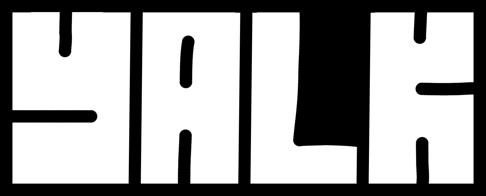

> [!WARNING]
> The game is in early development and everything may change before release.

<b> [Releases](https://github.com/UnhealLarps/Yalk/releases) | [Discord](https://discord.gg/y2wBXQThc9) </b>

## An experimental 2D multiplayer shooter game. 

# Getting started
1. Install [build from release](https://github.com/UnhealLarps/Yalk/releases)
2. Extract to any folder
3. Launch and play.

Servers you can find on our discord server. 

## Custom maps
### Installation
1. Install map with right format (.pck)
2. Place it in `%APPDATA%\Godot\app_userdata\Yalk\maps\` (or `~/.local/share/godot/app_userdata/Yalk/maps/` if you using linux)
### Creation
Check [wiki](https://github.com/UnhealLarps/Yalk/wiki)

## Features
For the basics, complete the in-game tutorial. For advanced details regarding game modes and mechanics, check out our [Wiki](https://github.com/unheallarps/yalk/wiki).

# License
All code for the content repository is licensed under the AGPL. 

- **Music** - Sourced from Pixabay under the Pixabay Content License. Also game using `Dragged Through Hellfire` by Zander Noriega
- **Sounds** - Sourced from free resources. 
